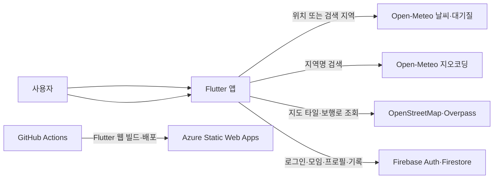

# 댕로드 (Dang-Road) 🐾

> **오늘의 환경과 산책로를 확인하고, 반려견과 걷는 시간을 기록하는 지역 기반 산책 앱**

[](app/pubspec.yaml)
[](https://flutter.dev)
[](https://azure.microsoft.com/products/app-service/static)

---

## 📱 앱 소개

**댕로드**는 대구 수성구를 기본 지역으로, 현재 날씨와 대기질, 주변 보행로를 한 화면에서 살펴볼 수 있는 Flutter 앱입니다. 위치 권한을 허용하거나 원하는 지역을 검색해 주변 정보를 확인할 수 있습니다.

현재 구현은 실제 공개 API와 Firebase 연동을 사용하는 기능 중심의 초기 버전입니다. 안전지수, 반려견 성향 기반 자동 추천, 실제 산책 GPS 추적처럼 아직 구현되지 않은 기능은 목업 데이터로 제공하지 않습니다.

### 🎯 현재 제공하는 가치

- **실제 환경 정보**: Open-Meteo의 기온·체감온도·습도·바람·대기질 조회
- **지역 선택**: 기기 위치 사용 또는 지역명 검색
- **실제 지도 정보**: OpenStreetMap 지도 타일과 주변 보행로 표시
- **계정 기반 기록**: Firebase 설정 후 모임, 반려견 정보, 산책 기록 저장
- **위치 최소화**: 현재 위치는 조회에 사용하며 Firestore에 좌표를 저장하지 않음

---

## ✨ 주요 기능

### 1️⃣ 홈 — 현재 환경

- 선택 지역의 현재 기온, 체감온도, 습도, 풍속 조회
- PM10, PM2.5 및 US AQI 조회
- 내 위치 사용 또는 지역 검색
- 데이터 로딩·오류 상태와 갱신 시각 표시

> 표시 정보는 외부 API 관측값을 바탕으로 한 참고 정보이며 산책 안전을 보장하지 않습니다. 현재 안전지수 계산이나 수의학적 판단은 제공하지 않습니다.

### 2️⃣ 코스 — 실제 지도와 주변 보행로

- OpenStreetMap 타일을 사용한 지도
- OpenStreetMap/Overpass에 등록된 주변 보행로 geometry 표시
- 경로 구간 길이와 OSM 객체 정보 표시
- 현재 위치 또는 검색한 지역을 중심으로 조회
- 데이터가 없거나 공개 서버가 응답하지 않을 때 오류·빈 상태 제공

지도상의 보행로는 검수된 반려견 산책 코스나 통행 가능성을 보증하지 않습니다. 공사, 출입 제한, 노면 상태는 현장에서 확인해야 합니다.

### 3️⃣ 함께 걷기 — 지역 모임

Firebase Authentication과 Cloud Firestore 설정 후 사용할 수 있습니다.

- 이메일/비밀번호 회원가입 및 로그인
- 모임 생성: 이름, 대략적인 지역, 일정, 참여 인원
- 열린 모임 실시간 목록 조회 및 참여
- 예정 시간이 지난 모임은 목록에서 제외
- 정확한 좌표 대신 대략적인 지역만 게시

실시간 채팅, 신고·차단, 모임 취소·운영자 검수는 아직 구현되지 않았습니다.

### 4️⃣ 내 기록 — 반려견과 산책 기록

Firebase 설정 후 계정별로 저장됩니다.

- 반려견 이름, 체급, 에너지 레벨, 사회성 저장
- 산책 장소, 거리, 시간, 메모 수동 기록
- 산책 횟수와 누적 거리 확인
- 본인 산책 기록 삭제

GPS 자동 기록, 자동 코스 추천 반영, 후기·사진 등록은 아직 구현되지 않았습니다.

---

## 🛠️ 기술 스택

| 영역 | 기술 |
|------|------|
| 앱 | Flutter, Dart, Material 3 |
| 지도 | `flutter_map`, OpenStreetMap 타일 |
| 보행로 | OpenStreetMap Overpass API |
| 날씨·대기질·지역 검색 | Open-Meteo APIs |
| 위치 | `geolocator` |
| 계정 | Firebase Authentication (이메일/비밀번호) |
| 모임·프로필·기록 저장 | Cloud Firestore |
| 웹 배포 | Azure Static Web Apps Free, GitHub Actions |

Google Maps API 키나 별도 날씨 API 키는 필요하지 않습니다. OpenStreetMap과 Open-Meteo 공개 서비스의 이용 정책·쿼터·가용성을 따라야 합니다.

---

## 🧭 데이터 흐름



---

## 🚧 구현 범위와 다음 단계

### 현재 구현

- 4개 탭 화면과 탭 이동
- 실제 환경 데이터와 지역 검색
- OSM 지도 및 보행로 표시
- Firebase 이메일 인증 UI
- Firestore 모임 생성·참여
- Firestore 반려견 프로필 및 산책 기록
- Firestore 보안 규칙 초안

### 출시 전 필요한 작업

- Firebase Console에서 이메일 로그인을 활성화하고 Firestore를 생성
- Firestore 보안 규칙을 검토·배포하고 실제 사용자 계정으로 통합 검증
- 반려견별 안전 기준과 설명 가능한 안전지수 정의
- 검수된 코스 데이터와 코스 운영 상태 구축
- 모임 취소·신고·차단·관리자 검수 기능
- 계정 탈퇴 및 개인정보 삭제 흐름
- Android/iOS Firebase 설정과 네이티브 인증 검증

---

## 🚀 시작하기

### 요구 사항

- Flutter stable 3.44.2 권장
- Dart SDK `^3.12.2`
- 웹 브라우저
- 위치 사용 시 HTTPS 또는 localhost와 브라우저 위치 권한

### 설치 및 실행

저장소 루트에서 PowerShell 기준으로 실행합니다.

```powershell
Set-Location app
flutter pub get
flutter run -d chrome
```

위치 권한을 허용하지 않아도 지역 검색으로 사용할 수 있습니다.

### 검사 및 웹 빌드

`app/` 디렉터리에서 실행합니다.

```powershell
flutter analyze
flutter test
flutter build web --release
```

빌드 결과는 `app/build/web`에 생성됩니다.

---

## 🔐 Firebase 설정

웹 설정은 `app/lib/firebase_options.dart`의 `dang-dcd02` 프로젝트를 사용합니다. 실제 로그인과 Firestore 기능을 사용하려면 Firebase Console 설정이 필요합니다.

1. Firebase Authentication에서 이메일/비밀번호 제공자를 활성화합니다.
2. Cloud Firestore 데이터베이스를 생성합니다.
3. 승인 도메인에 `localhost`, 배포 도메인 `witty-hill-03dbc8b00.2.azurestaticapps.net`, 사용하는 사용자 도메인을 등록합니다.
4. 저장소 루트에서 Firebase CLI 로그인 후 보안 규칙을 배포합니다.

```powershell
firebase login
firebase deploy --only firestore:rules
```

상세 절차와 데이터 접근 경계는 [FIREBASE_SETUP.md](FIREBASE_SETUP.md), 규칙은 [firestore.rules](firestore.rules)에 있습니다. 배포 전 규칙을 검토하세요. 현재 규칙에는 신고·차단, 모임 취소, 계정 삭제 흐름이 포함되어 있지 않습니다.

Android/iOS에서 Firebase를 사용하려면 FlutterFire로 네이티브 플랫폼 설정을 생성해야 합니다. 현재 저장소의 Firebase 옵션은 웹용입니다.

---

## ☁️ Azure 배포

Azure Static Web Apps **Free** 요금제에 기존 배포 구성이 있습니다.

- 서비스 URL: [witty-hill-03dbc8b00.2.azurestaticapps.net](https://witty-hill-03dbc8b00.2.azurestaticapps.net)
- 가격: Free 요금제 한도 내 Azure 호스팅 비용 $0; SLA 없음
- Azure CLI: 리소스 확인과 기존 배포 토큰 조회
- 업로드: `@azure/static-web-apps-cli`의 `swa deploy`
- 빌드: Flutter 3.44.2로 `flutter build web --release`
- 워크플로: `.github/workflows/azure-static-web-apps-witty-hill-03dbc8b00.yml`이 main 변경을 감지하고 `.github/workflows/flutter-web-deploy.yml`을 호출
- 배포 자격 증명: GitHub Repository Secret에 보관

2026-10-24에 현재 Flutter 웹 산출물을 기존 production 환경에 직접 배포했습니다. Azure CLI에는 빌드 파일 업로드 명령이 없으므로, Azure CLI로 토큰을 메모리에 가져오고 SWA CLI가 업로드합니다. 다음은 저장소 루트가 아닌 `app/` 디렉터리에서 실행합니다.

```powershell
flutter build web --release
Copy-Item .\staticwebapp.config.json .\build\web\staticwebapp.config.json -Force
$deploymentToken = az staticwebapp secrets list --name dang-road-web --resource-group rg-dang-road-web --query 'properties.apiKey' -o tsv
if ($LASTEXITCODE -ne 0 -or [string]::IsNullOrWhiteSpace($deploymentToken)) { throw 'Could not retrieve deployment token.' }
$env:SWA_CLI_DEPLOYMENT_TOKEN = $deploymentToken
$deployExitCode = 1
try {
  swa deploy .\build\web --app-name dang-road-web --resource-group rg-dang-road-web --env production
  $deployExitCode = $LASTEXITCODE
} finally {
  Remove-Item Env:SWA_CLI_DEPLOYMENT_TOKEN -ErrorAction SilentlyContinue
  Remove-Variable deploymentToken -ErrorAction SilentlyContinue
}
if ($deployExitCode -ne 0) { throw "Deployment failed with exit code $deployExitCode." }
```

**현재 앱 코드와 문서 변경은 아직 Git에 커밋되지 않았습니다.** 직접 배포된 사이트는 최신 앱이지만, GitHub Actions는 `main`의 코드만 빌드합니다. 현재 소스를 커밋하지 않은 채 `main`에 다른 변경을 push하면 사이트가 저장소의 이전 코드로 다시 배포될 수 있습니다. Firebase와 GitHub 사용량은 Azure 호스팅 요금과 별도이며, Free 요금제의 한도 초과·무 SLA 조건을 확인하세요.

---

## 📂 프로젝트 구조

```text
.
├── app/
│   ├── lib/
│   │   ├── app_shell.dart
│   │   ├── pages/                 # 홈, 코스, 함께 걷기, 내 기록
│   │   ├── services/              # Firebase, 위치, 실시간 API
│   │   └── widgets/               # 로그인·지역 검색 공통 UI
│   ├── test/                      # 환경 정보 분류 테스트
│   ├── web/                       # 웹 메타데이터와 앱 매니페스트
│   └── pubspec.yaml
├── .github/workflows/             # Azure Static Web Apps 배포
├── firebase.json
├── firestore.rules
└── FIREBASE_SETUP.md
```

---

## 📋 라이선스 및 데이터 출처

- 지도 타일 및 보행로 데이터: [© OpenStreetMap contributors](https://www.openstreetmap.org/copyright), ODbL 조건 적용
- 날씨·대기질·지오코딩: [Open-Meteo](https://open-meteo.com/)
- 외부 데이터는 지연·누락·서비스 제한이 발생할 수 있습니다. 안전한 산책 여부와 현장 통행 상태를 별도로 확인하세요.
